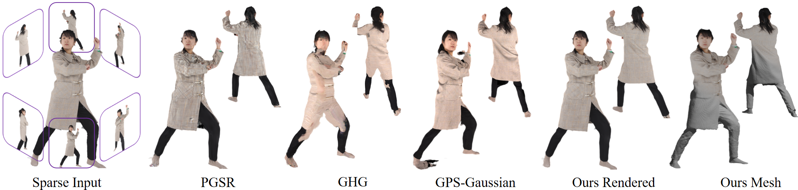
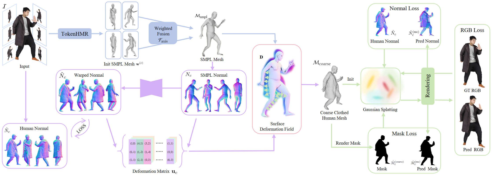
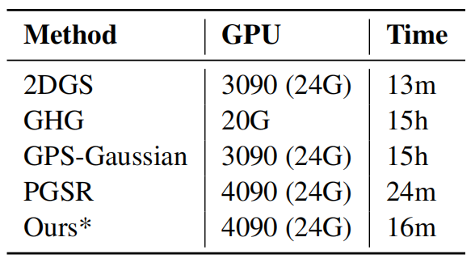
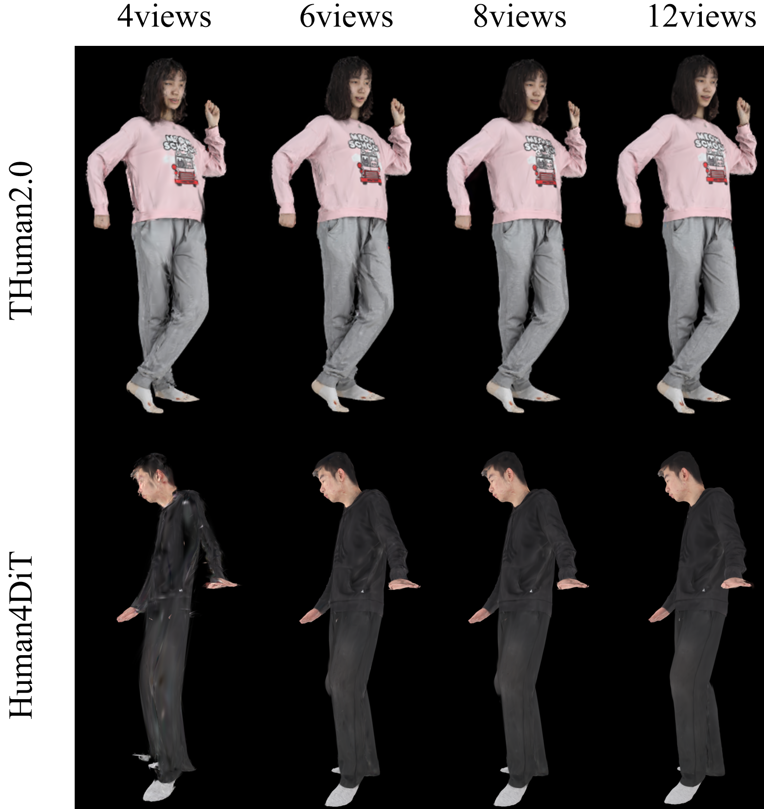
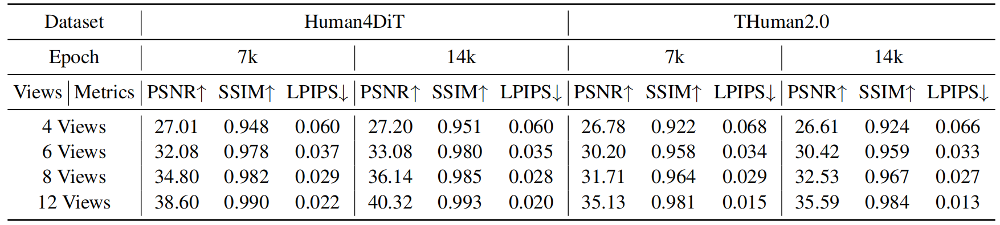
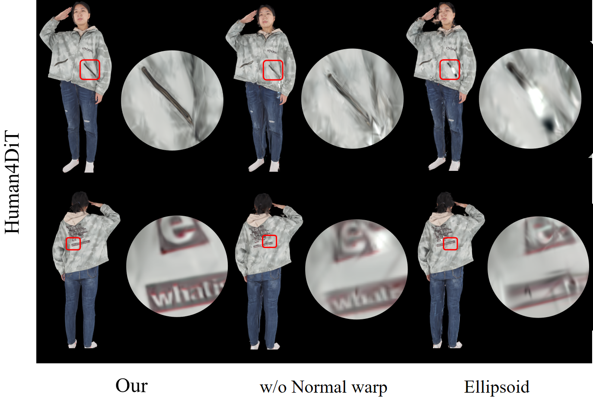
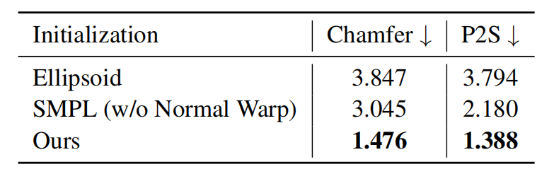
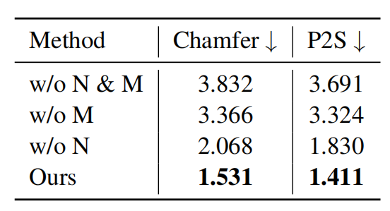
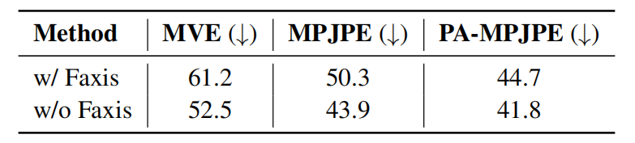

  <h1 align="center" style="font-size: 28px;">
    Geo-Human: Geometrically-Guided 3D Gaussian Splatting  
  for High-Fidelity Human Reconstruction Under Sparse Views
  </h1>

  

    <a href="https://github.com/The-GUAN"><strong>Jinfeng Guan</strong></a> ·
    <a href="https://scholar.google.com.hk/citations?user=j9d8QPgAAAAJ&hl=zh-CN"><strong>Yunqi Gao</strong></a> ·
    <a href="https://orcid.org/0009-0006-9198-1650"><strong>Zunian Wan</strong></a> ·
    <a href="https://github.com/zhaojiancheng007"><strong>Jiancheng Zhao</strong></a> ·
    <a href="https://www.ogawa-lab.org/people/?page_id=259"><strong>Takefumi Ogawa</strong></a>
  

  

    
  

 
Geo-Human combines mesh priors with 3DGS to reconstruct high-fidelity humans from sparse views, improving geometry and texture consistency.
 

## News :triangular_flag_on_post:

- [2025/9/28] Both key section codes and supplementary experiments are available.
- [2025-12-20] We have updated the **Supplementary Materials**.

## Abstract

we propose Geo-Human, a human reconstruction framework that combines the geometric stability of traditional mesh-based methods with the high-fidelity rendering of 3DGS, substantially improving the reconstruction quality and consistency with sparse views. Given a few input views, the corresponding SMPL models are first estimated and fused via a weighted blending scheme to obtain an accurate overall representation. An encoder-decoder network then transforms the model’s normals into image-space normals to compute a deformation field. This deformation field warps the mesh, generating a coarse clothed human model consistent with the input image cues. The resulting mesh serves as a robust initialization for 3D Gaussian Splatting, and the optimization is further supervised by silhouette masks and normal maps inferred from the input images to enhance reconstruction fidelity and multi-view consistency. Experimental results demonstrate that Geo-Human significantly outperforms existing state-of-the-art methods in both geometric accuracy and rendering of novel views on the Human4DiT and THuman2.0 datasets.

## Overview

    

Given six images, we first estimate a pose-accurate SMPL mesh using <a href="https://github.com/saidwivedi/TokenHMR">TokenHMR</a>. A surface deformation flow is then computed via normal map alignment (Normal Warp) to generate a coarse clothed mesh. The reconstructed mesh and multi-view masks are used to initialize surface-aligned Gaussian primitives, enabling high-fidelity novel view synthesis and refined human reconstruction.

## visualization results🎥

  
  
  

  
  

  <em>Visualization of reconstructed humans under sparse views — each example demonstrates our geometry-consistent Gaussian representation.</em>

## Experiments
- ### Total loss.
Incorporating the above mask loss and normal loss, our method ultimately optimizes the following weighted total loss function:

L_total = L_rgb + λ1 L_s + λ2 L_sv-geo + λ3 L_mv-rgb  
　　　　+ λ4 L_mv-geo + λ5 L_mask + λ6 L_normal

The total loss function includes the photometric reconstruction loss L_rgb, the Gaussian flattening loss L_s, the single-view geometric loss L_sv-geo, the multi-view photometric consistency loss L_mv-rgb, the multi-view geometric consistency loss L_mv-geo, and the proposed mask loss L_mask for additional supervision.

The normal loss is applied starting from the 7000th iteration.

The weights are empirically set as:
- λ1 = 100  
- λ2 = 0.01  
- λ3 = 0.2  
- λ4 = 0.05  
- λ5 = 0.8  
- λ6 = 0.015  

Higher weights are assigned to geometry-critical terms (L_s, L_mask), while lower weights are used for auxiliary regularizers.

- ### Efficiency.

    
    

        <b>Table 1:</b> Quantitative Comparison of Training Time. 
        <i>*: with the number of iterations set to 1,4000.</i>
    

In table 1, Our training speed only requires 16 minutes on a single GPU, while the state-of-the-art method based on Generative Model(eg:GHG ,GPS-Gaussian ) requires over 15 hours.

## Ablation Study

- ### Comparison of the Number of Input Views.

    

    
    

      <b>Table 2:</b> Comparison of different input views and training epochs on Human4DiT and THuman2.0.
  

It is evident that our approach achieves accurate physical structure reconstruction and produces high-fidelity novel-view images from a limited number of input views.
Even when the number of input views is reduced to four, our method still outperforms most competing approaches.

- ### Comparison of Initialization and Normal Warp.

    

    
    

      <b>Table 3:</b> Comparison of different initializations in 6 input views.
  

To validate the effectiveness of our initialization point cloud and Normal Warp, we replaced the initial point cloud with an ellipsoidal point cloud of the same size and an SMPL mesh without Normal Warp. Table demonstrates that an accurate human prior can enhance the quality of human reconstruction and also validates the effectiveness of the Normal Warp.

- ### Comparison of Loss Strategy.

    
    

    <b>Table 4:</b> Ablation study of loss strategy on Human4DiT. Input views set to 6.

To validate the effectiveness of the normal loss and mask loss, we compare four variants in the final mesh reconstruction: w/o both normal and mask loss, w/o normal loss, w/o mask loss, and our full method. As shown in Table, the results confirm the effectiveness of our loss strategy, demonstrating that the normal and mask loss further optimizes the 2D Gaussian points, enabling Geo-Human to achieve more physically accurate geometry modeling.

- ### Comparison of Weighted Fusion.

    
    

    <b>Table 5:</b> Ablation study on axis-weighted fusion (<i>Faxis</i>) in pose estimation. The reported results are averaged over 50 human samples selected from the Human4DiT and THuman2.0 dataset.

As shown in Table, the effectiveness of our Weighted Fusion strategy is validated by consistently outperforming the single-view TokenHMR baseline across all three metrics. It enables more accurate SMPL mesh estimation and demonstrates improved robustness in handling complex human poses.

